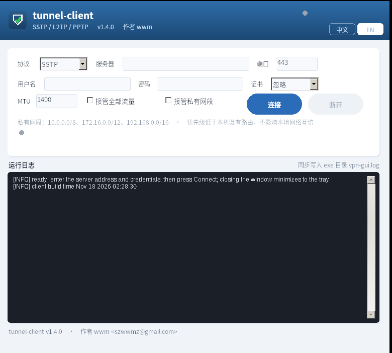
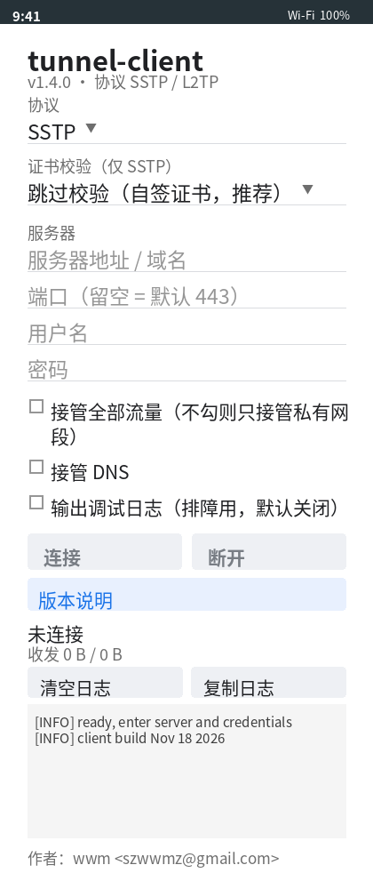

# tunnel-client 使用说明（手机 / Windows）

> 版本 v1.4.0 · 适用于 Windows 10/11 与 Android 7.0 及以上

**一句话上手**：填服务器、**端口 `446`**、用户名、密码 → 协议选 **SSTP** → 点“连接”。

> **建议使用 SSTP。** 它走 TCP 443，和 HTTPS 网页流量特征完全一样，在公司、酒店、校园网、手机流量下最不容易被封，穿透性最好。

> **注意：我司端口统一为 446。** SSTP 的标准端口是 443，本公司的服务器已全部改为 **446**。连接我司服务器时，**端口一栏必须手动填 `446`**（Windows 与手机版相同），留空或填 443 都会连不上。



---

## 一、这个软件解决什么问题

### 手机（Android）

- **系统没有 SSTP。** 安卓自带的 VPN 只有 PPTP / L2TP-IPsec 一类，而很多服务器（如 RouterOS）默认只开 SSTP，手机上根本连不上。
- **系统 L2TP/IPsec 配置太复杂。** 要填预共享密钥、IPsec 标识、DNS、路由，普通用户对着教程也常常填错。
- **其它安卓隧道 App** 要么收费、要么要 root、要么全英文。

### 电脑（Windows）

- **系统自带 SSTP 强制校验证书。** 服务器用自签证书时直接报错，普通用户不会导证书、也不会关校验。
- **系统自带 L2TP 经常连不上。** 它依赖 UDP 500/4500 和 1701，运营商、酒店、校园网经常把这些端口封掉。
- **系统 VPN 界面参数多、报错含糊**，出问题时看不出是证书、密码还是端口的问题。

### 本软件的做法

| 常见麻烦 | 本软件的处理 |
|---|---|
| 证书校验太严，自签证书连不上 | 证书一项可选“忽略”，一键连上；也会明确提示风险 |
| 端口被封就废了 | SSTP 端口可改（默认 443，我司为 446），换个端口即可绕过封锁 |
| 手机上没有 SSTP | 内置 SSTP 协议栈，安卓无需 root |
| 配置项太多 | 界面只有 4 个必填项：服务器、端口、用户名、密码 |
| 依赖系统 VPN 组件、受系统策略限制 | 自带协议栈和虚拟网卡，不调用系统 VPN |

---

## 二、协议怎么选：优先 SSTP

| 协议 | 端口 | 加密 | 推荐度 | 说明 |
|---|---|---|---|---|
| **SSTP** | TCP **443**（默认，我司 **446**） | TLS + MPPE | ★★★★★ **首选** | 与 HTTPS 同端口，穿透性最好；支持自签证书 |
| L2TP | UDP **1701**（固定） | 无（纯 L2TP） | ★★ | 服务器必须关闭 IPsec；数据不加密；1701 常被运营商封 |
| PPTP | TCP 1723 | 弱（已可破解） | ★ | 仅在别无选择时用；**手机版不支持** |

**结论**：能用 SSTP 就用 SSTP。只有服务器明确只开了纯 L2TP 且运营商没封 1701 时，才考虑 L2TP。SSTP 出厂默认 `443`，**我司统一用 `446`**，下文示例均按 `446` 填写。

---

## 三、Windows 版

### 1. 下载与解压

1. 打开下载地址 <https://www.edcwifi.com/tunnel-client-all-1.4.0.zip>，浏览器会自动开始下载；若没有反应，右键选“链接另存为”
2. 在“下载”文件夹里找到 `tunnel-client-all-1.4.0.zip`，右键 → “全部解压缩”
3. 解压后进入 `windows` 目录，里面有：

```
vpn-gui.exe       主程序 —— 要运行的就是它
wintun.dll        虚拟网卡驱动，必须和 exe 放在同一目录
README.txt        说明文本
licenses/         第三方组件许可
```

**运行哪个文件**：双击 `vpn-gui.exe`。这是整个目录里唯一的程序入口；`wintun.dll` 是它调用的驱动文件，`README.txt` 是文本说明，这两个都不要双击。

> - 不要只把 `vpn-gui.exe` 单独拷走，缺少 `wintun.dll` 会启动失败。
> - 不要在压缩包里直接双击运行（会解压到临时目录，配置文件 `vpn-gui.ini` 和日志会散落在临时文件夹里）。**先完整解压，再进入 `windows` 目录运行。**

### 2. 启动

双击 `vpn-gui.exe`。程序会**自动请求管理员权限**（创建虚拟网卡需要），在系统弹窗中点“是”。

若 Windows 防火墙询问是否允许联网，选择“允许”。

### 3. 界面说明


| 位置 | 填写内容 |
|---|---|
| **协议** | 选 `SSTP`（推荐）/ `L2TP` / `PPTP` |
| **服务器** | 服务器域名或 IP，例如 `vpn.example.com` |
| **端口** | SSTP 默认 `443`，**我司服务器请填 `446`**；可改，选 L2TP/PPTP 时自动锁定（变灰） |
| **用户名 / 密码** | 服务器分配的 VPN 账号 |
| **证书** | 默认“忽略”（自签证书可直接连）；服务器用正规证书时建议改选“校验” |
| **MTU** | 默认 `1400`，一般不用改 |
| **接管全部流量** | 勾选后所有上网流量走 VPN（0.0.0.0/0） |
| **接管私有网段** | 只把 10.0.0.0/8、172.16.0.0/12、192.168.0.0/16 指向 VPN；优先级低于本机已有路由，不影响访问本地打印机、NAS 等 |
| **连接 / 断开** | 开始或结束连接 |
| **运行日志** | 实时日志，同时写入 exe 旁的 `vpn-gui.log` |

两个路由选项都不勾时，只有服务器下发的地址段可用，基本访问不了外网——**需要上网就勾“接管全部流量”**。

右上角 `中文 / EN` 可随时切换界面语言。

### 4. 连接

1. 填好服务器、端口 `446`、用户名、密码
2. 协议选 **SSTP**
3. 点“连接”

状态会依次显示：`连接中` → `认证中` → `已连接`。

失败时会显示 `连接失败`，具体原因看下方日志，例如：

- `certificate verify failed` → 证书选“忽略”
- `timeout` / `connect failed` → 服务器地址写错，或端口被封（换端口再试）
- `auth failed` → 用户名或密码错误

### 5. 托盘与退出

- 点窗口右上角 **×** 不会退出，而是缩到右下角托盘（避免误断）
- 双击托盘图标 → 恢复窗口
- 右键托盘图标 → 连接 / 断开 / 版本说明 / 退出
- **要彻底退出**：托盘图标右键 → 退出

### 6. 配置文件（一般用不到）

第一次点“连接”时会自动在 exe 同目录生成 `vpn-gui.ini`，下次启动自动恢复上次的填写内容。可用记事本编辑：

```ini
proto=0        ; 0=SSTP 1=L2TP 2=PPTP
host=vpn.example.com
port=446        ; 默认 443，我司用 446
user=alice
pass=******    ; 已混淆，不是明文
cert=1         ; 0=校验 1=忽略
mtu=1400
routeall=1     ; 1=接管全部流量
routepriv=0    ; 1=接管私有网段
vpndns=1       ; 1=使用 VPN 下发的 DNS
debug=0        ; 1=输出逐包调试日志（排障用，改完要重启）
lang=zh        ; zh / en
```

---

## 四、手机（Android）版

### 1. 安装

1. 用手机浏览器打开下载地址 <https://www.edcwifi.com/tunnel-client-android-1.4.0.apk>，下载安装包 `tunnel-client-android-1.4.0.apk`
2. 下载完成后在通知栏或“文件管理 → 下载”里点击该文件安装；系统提示“未知来源应用”时，允许本次安装即可
3. 安装完成，桌面出现 **tunnel-client** 图标，点击运行

### 2. 界面说明



*（上图为界面示意，实际图标、系统字体可能略有差异）*

| 位置 | 填写内容 |
|---|---|
| **协议** | `SSTP`（推荐）或 `L2TP（无 IPsec）` |
| **证书校验（仅 SSTP）** | 默认“跳过校验（自签证书，推荐）”；选“严格校验”必须先在应用数据目录放入 `ca.pem`，否则连接会失败，普通用户保持默认即可 |
| **服务器** | 域名或 IP |
| **端口** | 留空 = SSTP 443；**我司请填 `446`**。L2TP 固定 1701 |
| **用户名 / 密码** | VPN 账号 |
| **接管全部流量** | 勾选 = 全部走 VPN；不勾 = 只接管私有网段 |
| **接管 DNS** | 用服务器下发的 DNS（建议勾选） |
| **输出调试日志** | 排障时打开，平时关闭 |
| **连接 / 断开** | 开始 / 结束连接 |
| **清空日志 / 复制日志** | 复制后可粘贴到微信等发给管理员 |

### 3. 首次连接

1. 填好服务器、端口 `446`、用户名、密码，协议选 **SSTP**
2. 点“连接”
3. 系统弹出 **“连接请求：tunnel-client 想要设置 VPN 连接”** → 点“确定”（只需授权一次）
4. 成功后状态显示“已连接”并显示分配到的地址，通知栏出现常驻通知；界面下方有实时收发统计

### 4. 关于 L2TP

手机的 L2TP 是**纯 L2TP，不带 IPsec**，因此：

- 服务器端必须关闭 IPsec。RouterOS 上是：
  ```
  /interface l2tp-server server set use-ipsec=no
  ```
- 手机与服务器之间要能通 UDP 1701
- 此模式**不加密**，只适合内网或临时使用。**有 SSTP 就别用 L2TP。**

### 5. 手机上不支持 PPTP

PPTP 需要发送 GRE（IP 协议 47）原始数据包，未 root 的安卓应用没有这个权限，所以协议列表里不提供 PPTP。这不是 bug。

---

## 五、常见问题

| 现象 | 处理 |
|---|---|
| 提示证书错误、连不上 | 证书改选“忽略”（自签证书的常见情况） |
| 显示已连接，但打不开网页 | 勾“接管全部流量”；Windows 上确认 `vpndns=1` |
| 一直停在“连接中”然后失败 | 服务器地址或端口错；**我司端口是 `446`，别用默认 443**；换端口（SSTP 可改）再试；确认手机/电脑能访问该端口 |
| 换网络后断开 | 程序会自动重连（状态显示“重连中”）；长时间不恢复就手动断开再连 |
| L2TP 连不上 | 服务器 IPsec 没关，或 UDP 1701 被封 → 改用 SSTP |
| 关掉窗口后程序还在 | 正常，已缩到托盘；托盘右键 → 退出 |
| 想看详细日志 | Windows：`vpn-gui.ini` 里 `debug=1` 后重启；Android：勾“输出调试日志” |
| 忘了之前填的密码 | Windows：`vpn-gui.ini`（混淆保存）；Android：应用数据里，可重新输入 |

---

## 六、安全提示

1. **“忽略证书”只适合自签证书或内网环境**。它不校验服务器身份，理论上可被中间人冒充；服务器证书受信任时请改选“校验”。
2. **PPTP 不安全**，其认证方式已被公开破解，仅在别无选择时使用。
3. **纯 L2TP 不加密**，数据在公网上是明文。
4. 密码保存在本地（Windows 为混淆存储、非加密；Android 存在应用私有目录），共用电脑请勿保存密码，用完在托盘退出。
